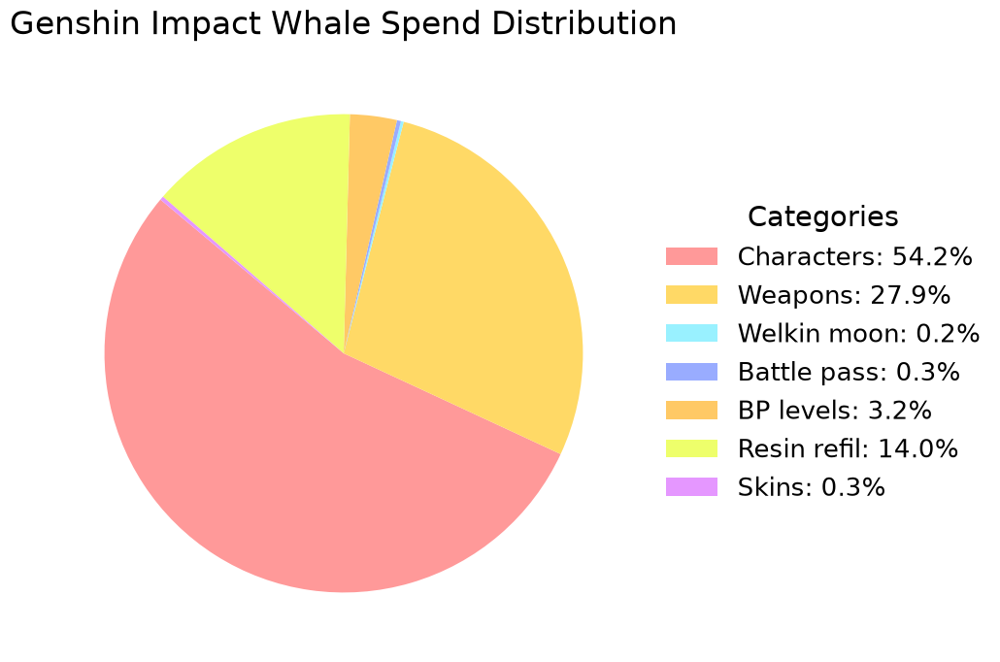

# Genshin Impact - Whale Calculator
This is a calculator that estimates how much a Genshin Impact whale can spend in the game.

## Pie Spend Distribution

## Table Spend Distribution

| Type | Spend (EUR) | Spend (USD) | Share |
| :--- | :--- | :--- | :--- |
|All C6 characters|102906.71|106089.39 | 54.16% |
|All R5 weapons|52956.70|54594.54 | 27.87% |
|Welkin moon|358.18|369.26 | 0.19% |
|Battle pass|513.59|529.47 | 0.27% |
|Battle pass levels|6013.40|6199.38 | 3.16% |
|Daily resin refil|26769.32|27597.24 | 14.09% |
|All Skins|484.95|499.95 | 0.26% |
| |
| **Total** | **190002.85 EUR** |195879.23** USD** | **100%** |

**!!!** 
The result represents a theoretical cost, not an average or realistic outcome.

